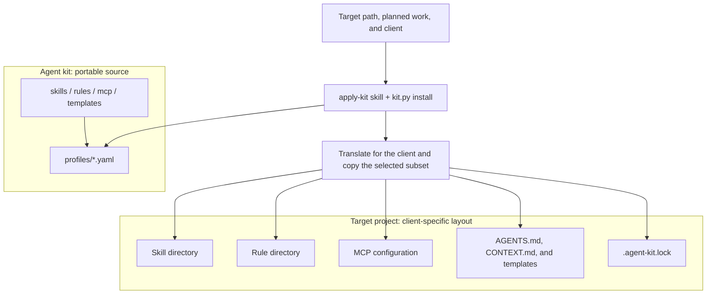

# Agent kit

A library of portable agent skills, rules, MCP definitions, and templates, grouped into profiles. Describe your project to your agent, and it installs the matching profile for your client: Cursor, Claude Code, OpenCode, or Codex. This repository is the source; the assets end up in your projects.

## How it works

Assets are written once, in a client-neutral form, and grouped into catalogs for authors. A profile (`profiles/*.yaml`) is the only install list: which skills, rules, MCP definitions, and templates a project gets.

The installer is [scripts/kit.py](./scripts/kit.py). It writes the chosen assets in the layout of each agent client: Cursor, Claude Code, OpenCode, or Codex (skills, rules, MCP configuration), and records what it installed in `.agent-kit.lock`. Skills already present are updated from the kit; rules, templates, and MCP entries are skipped unless `--force`.

Profiles stack: `core` is always added, and you pick the rest (`architecture`, `engineering`, `spike`, and others). The installer never runs on this repository itself. After installing, work in the target project with the client you installed for.



## Layout

| Path | Role |
|------|------|
| [skills/](./skills/) | Procedures (`SKILL.md` folders), nested for authors |
| [rules/](./rules/) | Rule sources (`.mdc`); the installer converts them per client |
| [profiles/](./profiles/) | Which skills, rules, MCP definitions, and templates a target receives |
| [mcp/](./mcp/) | Portable MCP definitions; the installer converts them per client |
| [templates/](./templates/) | Files copied into the target (`AGENTS.md`, `CONTEXT.md`, arc42 stubs) |
| [scripts/](./scripts/) | `kit.py` command line and the `agent_kit` package |
| [tests/](./tests/) | Unit tests for the scripts |
| [pyproject.toml](./pyproject.toml) | Dependencies and Ruff, mypy, pytest settings (`uv.lock` pins versions) |
| [CONTRIBUTING.md](./CONTRIBUTING.md) | How to contribute: add a skill, rule, MCP fragment, template, or profile |
| [AGENTS.md](./AGENTS.md), [CLAUDE.md](./CLAUDE.md) | Instructions for agents working in this repository (`CLAUDE.md` imports `AGENTS.md`) |
| [CHANGELOG.md](./CHANGELOG.md) | Release notes |
| [LICENSE](./LICENSE) | MIT License |

## Install into a project

Open this repository in your agent (Cursor, Claude Code, OpenCode, Codex) and describe the target path, the work planned there, and which client you use in it. The agent follows the `apply-kit` skill (linked from [AGENTS.md](./AGENTS.md)): it picks profiles and runs the installer. You do not need to set up an environment first: if [uv](https://docs.astral.sh/uv/) is missing, the agent offers to install it (through `pip` when Python is present, otherwise with the official uv installer) and waits for your yes. If you decline, it can still copy the skills; rules and MCP servers then wait until the installer can run.

Or run it yourself with [uv](https://docs.astral.sh/uv/) (it sets up Python 3.12+ and Pydantic on first use):

```bash
uv run scripts/kit.py list
uv run scripts/kit.py install --target /path/to/repo --client cursor --profile architecture
uv run scripts/kit.py install --target /path/to/repo --client claude --profile architecture,engineering
uv run scripts/kit.py install --target /path/to/repo --client opencode --profile engineering,langgraph
uv run scripts/kit.py install --target /path/to/repo --client codex --profile llm-infra
uv run scripts/kit.py install --target /path/to/repo --client cursor,claude --profile frontend,playwright
```

| `--client` | Skills | Rules | MCP |
|------------|--------|-------|-----|
| `cursor` | `.cursor/skills/` | `.cursor/rules/*.mdc` | `.cursor/mcp.json` |
| `claude` | `.claude/skills/` | `.claude/rules/*.md` | `.mcp.json` |
| `opencode` | `.opencode/skills/` | `.opencode/rules/*.md` via `instructions` | `opencode.json` |
| `codex` | `.agents/skills/` | managed block in `AGENTS.md` | `.codex/config.toml` |

`core` is always added unless you pass `--no-core`. Without `--client` the installer detects the client from the target. Do not install into this repository. Without uv, run `python scripts/kit.py` in a Python 3.12+ environment with Pydantic 2.

Typical sets: `architecture`; `engineering`; `engineering,langgraph`; `spike` for hypothesis work. Add `frontend` for distinctive UI work, `playwright` to drive a browser, and `github` when the repo lives on GitHub. Add `llm-infra` for local Qdrant/Langfuse/MLflow/Ollama compose commands. Add `vllm` or `sglang` for a blank NVIDIA GPU server. Add `speckit` only if the repo already uses GitHub Spec Kit (`.specify/`). Add `reverse-engineering` only for authorized analysis of shipped artifacts or runtime behavior.

The installer writes `.agent-kit.lock` in the target root (kit revision, clients, installed items). Commit it with the target project. Details: [scripts/README.md](./scripts/README.md).

### What `core` supplies

- Skills: session (`handoff`, `grill-me`, `eli5`, `caveman`, `write-prompt`, and others), `apply-kit`, `code-review`, and [OpenSpec](https://github.com/Fission-AI/OpenSpec)
- Rules: language, skills, tests-on-request, imports-at-top, OpenSpec, and write-prompt
- MCP definitions: Context7 and [codegraph](https://github.com/colbymchenry/codegraph) (keys stay out of git)
- Templates: `AGENTS.md`, `CONTEXT.md`, and `docs/agents/issue-tracker.md`

### After installing

1. Open the target project in the client you installed for.
2. Set MCP secrets as environment variables that client can see (for example `GITHUB_PERSONAL_ACCESS_TOKEN`). Claude Code asks to approve project MCP servers; Codex reads `.codex/config.toml` only in trusted projects. Index the repository once for codegraph: `npx -y @colbymchenry/codegraph@1.6.2 init -y`.
3. OpenSpec needs Node.js **20.19+** and the `openspec` CLI. If `openspec/` is missing, run `openspec-init` (`openspec init --tools none --profile core`).
4. For a feature change, use `openspec-propose`; for an ad-hoc hypothesis use the `spike` profile and skill; for architecture documents use the `architecture` profile.

### Reverse-engineering targets

Use `reverse-engineering` only when the target project needs authorized analysis of a shipped binary, package, runtime behavior, or a comparable artifact. The profile supplies the version-pinned REA MCP definition and matching workflow skill. Node.js 22.19+, 24.11+, or 26+ and npm are required. Ghidra, IDA, and JADX are optional external providers and are not installed by Agent kit.

## Profiles

| Profile | Adds |
|---------|------|
| `core` | Always added (skip with `--no-core`): session helpers, `apply-kit`, code review, OpenSpec, Context7 and codegraph MCP |
| `architecture` | arc42 spine, C4, ADRs, quality scenarios, threat model, review, Archify diagrams, draw.io MCP |
| `engineering` | Domain modeling, module design, clean code, Python code style, GoF patterns, API design |
| `frontend` | Distinctive production UI (`frontend-design`) |
| `langgraph` | LangGraph fundamentals |
| `speckit` | GitHub Spec Kit (optional) |
| `spike` | Hypotheses and ad-hoc work |
| `llm-infra` | Local Docker catalog: Qdrant, Langfuse, MLflow, Postgres, Redis, Kafka, Ollama |
| `vllm` | vLLM on a blank NVIDIA GPU server |
| `sglang` | SGLang on a blank NVIDIA GPU server |
| `github` | Remote GitHub MCP server: repositories, issues, pull requests, Actions |
| `playwright` | Playwright MCP: drive a real browser for end-to-end checks and UI debugging |
| `reverse-engineering` | REA MCP definition plus an evidence-led workflow for authorized targets |

## Development

The scripts follow the `python-code-style` skill and are checked with Ruff,
strict mypy, and pytest; [scripts/README.md](./scripts/README.md) has the
commands. Read [CONTRIBUTING.md](./CONTRIBUTING.md) before adding a skill,
rule, MCP definition, template, or profile, then run
`uv run scripts/kit.py check`.

## Skill sources

Agent kit combines open-source skills from the community with skills written
for this kit.

**Open-source skills**, vendored and in places adapted. Each keeps its upstream
license and notice file next to it:

| Skills | Source | License |
|--------|--------|---------|
| `research`, `codebase-design`, `code-review`, `domain-modeling`, `improve-codebase-architecture`, `grill-with-docs`, `wayfinder`, `to-spec`, `to-tickets`, `triage`, `implement`, `tdd`, `prototype`, `diagnosing-bugs`, `resolving-merge-conflicts`, `wizard` | [mattpocock/skills](https://github.com/mattpocock/skills/tree/main/skills/engineering) (engineering) | MIT |
| `grill-me`, `grilling`, `handoff`, `teach`, `to-questionnaire`, `wait-what`, `writing-for-agents` | [mattpocock/skills](https://github.com/mattpocock/skills/tree/main/skills/productivity) (productivity) | MIT |
| `openspec-*` (except `openspec-init`) | [Fission-AI/OpenSpec](https://github.com/Fission-AI/OpenSpec) | MIT |
| `speckit-*` | [github/spec-kit](https://github.com/github/spec-kit) | see upstream |
| `archify` | [tt-a1i/archify](https://github.com/tt-a1i/archify) | MIT |
| `frontend-design` | [anthropics/skills](https://github.com/anthropics/skills) | Apache-2.0 |
| `eli5` | [anthropics/claude-plugins-community](https://github.com/anthropics/claude-plugins-community) | MIT |
| `caveman` | [JuliusBrussee/caveman](https://github.com/JuliusBrussee/caveman) | MIT |
| `reverse-engineer-anything` | [morluto/rea](https://github.com/morluto/rea) | MIT |
| `api-design-patterns` | [popey/ai1-skills](https://github.com/popey/ai1-skills) | MIT |
| `langgraph-fundamentals` | [langchain-ai/langchain-skills](https://github.com/langchain-ai/langchain-skills) | MIT |

**Original skills**, written for Agent kit by Vadim Shubin:

- Architecture: `system-design`, `arc42-c4`, `c4-diagrams`, `adr-write`, `quality-scenarios`, `threat-model`, `architecture-styles`, `architecture-review`, `architecture-lint`
- Engineering: `clean-code`, `python-code-style`, `dependency-injection`, `design-patterns`, `singleton-pattern`, `factory-pattern`, `spike`, and the GoF pattern skills with `design-patterns-catalog`
- Productivity and setup: `apply-kit`, `write-prompt`, `openspec-init`
- Stacks: `llm-infra`, `vllm-gpu`, `sglang-gpu`

Rules, MCP definitions, templates, profiles, and the installer are also
original to Agent kit.

## License

Agent kit is released under the [MIT License](./LICENSE). Vendored skills keep
their upstream licenses; see [Skill sources](#skill-sources).
