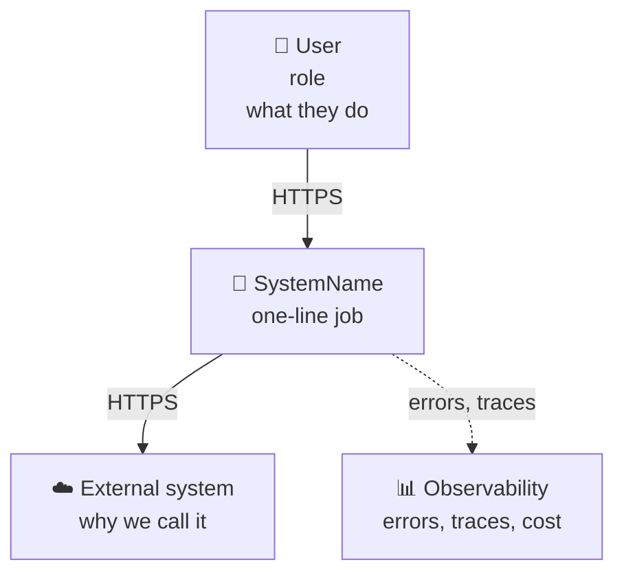
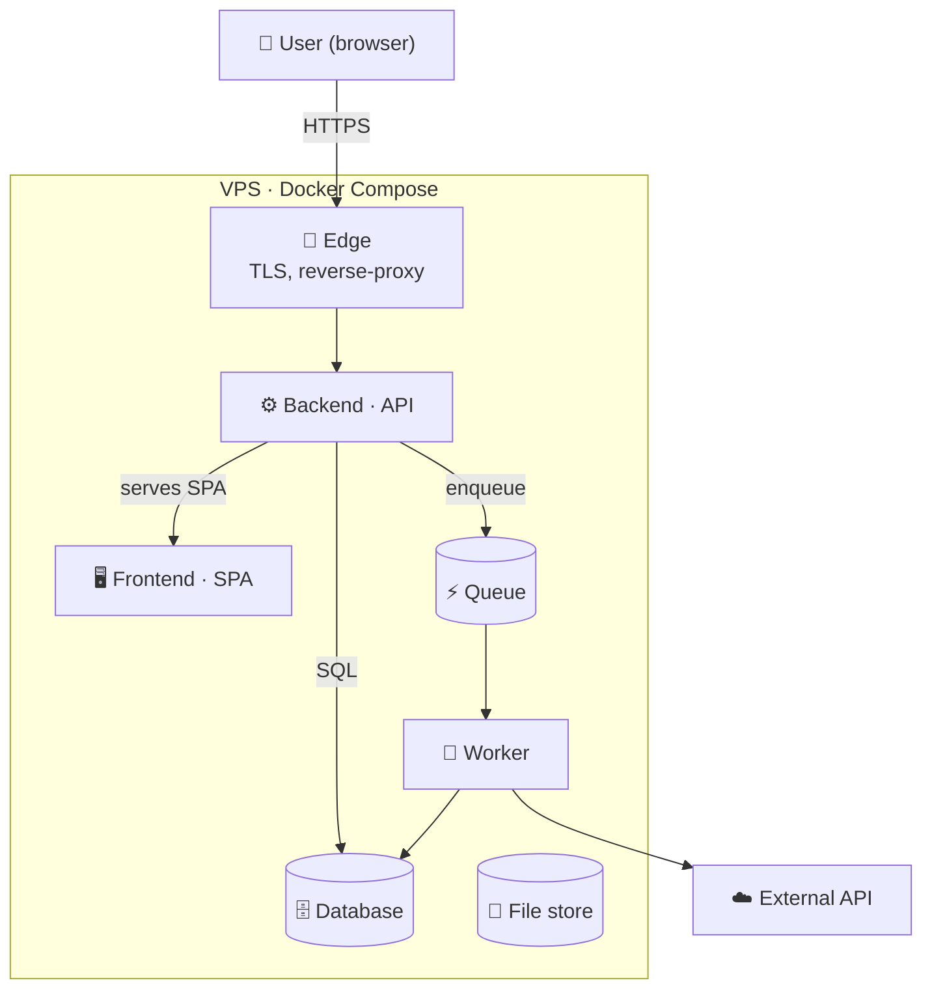
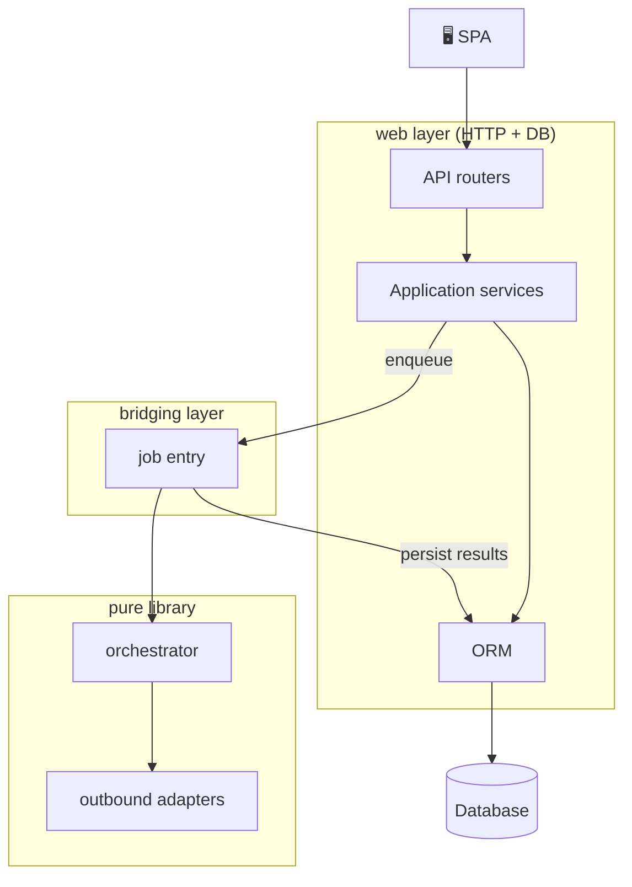
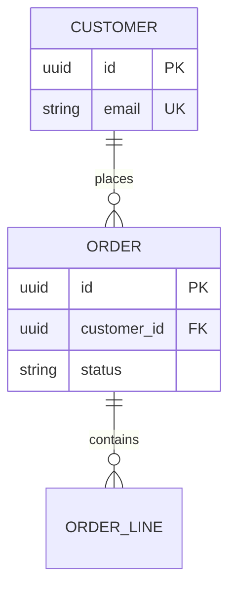
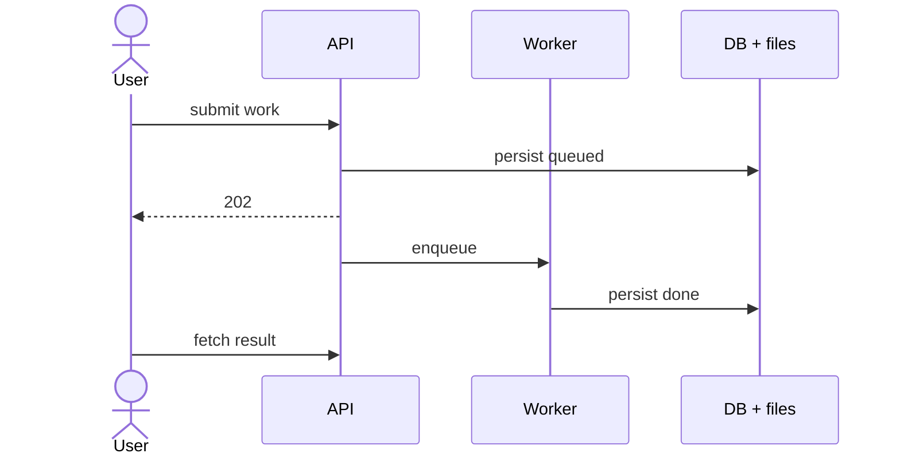

# C4 Mermaid scaffolds

Copy the structure; replace names from `CONTEXT.md`.

## C1 — System context

*Audience:* stakeholder — who uses the system and what it talks to externally.

Omit in-process libraries. Dash observability if the product continues when it is down.

## C2 — Containers

*Audience:* developer/DevOps — what deploys, where data and the queue live.

## C3 — Components (one container)

Show the **hard boundary** the ADR locked (e.g. pure library vs web).

*Audience:* developer — how one container is decomposed and where the seam sits.

## Level 4 — ERD (not code)

*Audience:* developer — persistence models are written from this schema.

## Sequence — key user path

Happy path only. Error branches belong in the API contract, not this figure.

