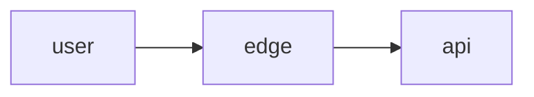

# Threat model

Find what can go wrong **in the design**, before it is code. Four questions: what are we building, what can go wrong, what do we do, did we cover it?

Method: [STRIDE](https://learn.microsoft.com/en-us/azure/security/develop/threat-modeling-tool-threats) on a data-flow view derived from C4. Prefer **STRIDE-per-interaction** on flows that cross a trust boundary (APIs, queues, object storage, third-party APIs).

Start from [c4-diagrams](../c4-diagrams/SKILL.md) C1/C2. Do not invent containers. Only systems the user owns or is authorized to assess.

## Workflow

1. **Assets** — data, credentials, availability, cost (e.g. payment-provider fees), reputation. Use `CONTEXT.md` names.
2. **DFD** — Mermaid flowchart: people, processes (containers), stores, flows labelled with *what* moves (`JWT`, `card token`, `order JSON`), not "request/response".
3. **Trust boundaries** — internet↔edge, tenant↔tenant, app↔DB, worker↔object store, app↔external API. Draw them; most threats live here.
4. **Enumerate STRIDE** per crossing flow (skip a category only with a reason):

| | Meaning | Typical control |
|--|---------|-----------------|
| **S**poofing | fake identity | authn, mTLS, signed webhooks |
| **T**ampering | change data in flight/at rest | TLS, checksums, signed cookies |
| **R**epudiation | deny an action | audit log, append-only events |
| **I**nformation disclosure | leak | authz, encryption, no secrets in URLs |
| **D**enial of service | exhaust | limits, timeouts, backpressure |
| **E**levation of privilege | extra rights | least privilege, owner checks |

5. **Rate** likelihood × impact (L/M/H). Mitigation must be *placed* (which container). Name residual risk you accept.
6. Structural mitigations that are hard to reverse → [adr-write](../adr-write/SKILL.md). Quality/security scenarios → [quality-scenarios](../quality-scenarios/SKILL.md).

## File

`docs/threat-model.md` (or `docs/security/threat-model.md` if that tree exists). If it still has `<...>` placeholders, it is the installed template: fill it in place and drop its HTML comments.

```markdown
# Threat model — <system>

**Based on:** docs/C4.md C2
**Date:**

## Assets
- …

## Trust boundaries
- Internet → Caddy
- App → PostgreSQL
- Worker → payment provider API

## DFD



## Threats

| ID | Flow | STRIDE | Threat | L | I | Mitigation | Residual |
|----|------|--------|--------|---|---|------------|----------|
| T-01 | User → API POST /orders | D | unbounded order creation | H | H | rate limit per customer in API | none for MVP |
```

End with: categories skipped (and why), top three risks, whether C2 still hides a store or trust boundary.

## Anti-patterns

- Generic "add more auth" with no container
- STRIDE on internal libraries (PDF renderer, SDK) as if they were C1 systems
- Exploit steps, payloads, or attacks on systems the user does not own
- Skipping Information Disclosure on logs/traces (cost/PII in Langfuse)
