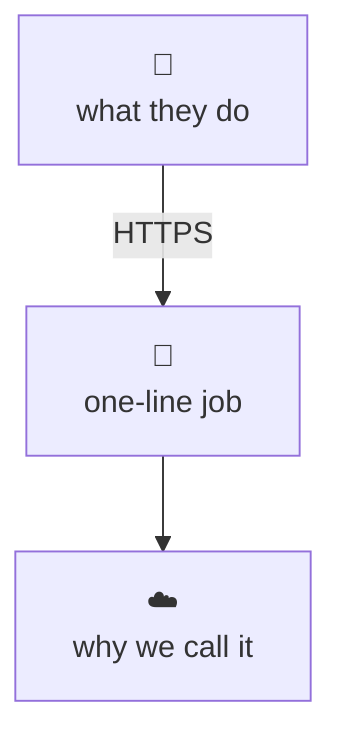
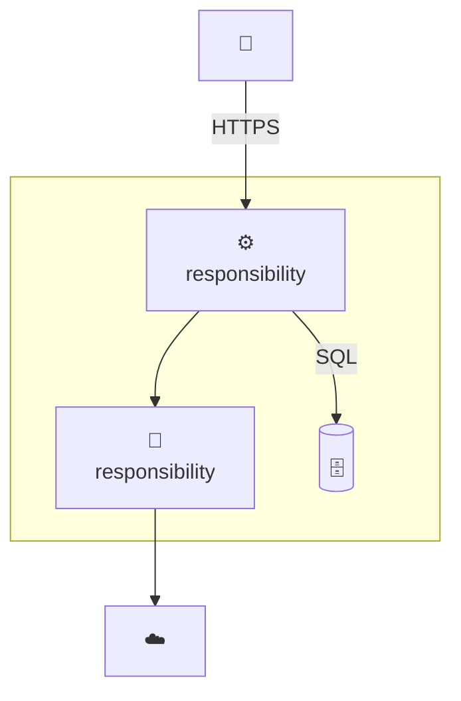
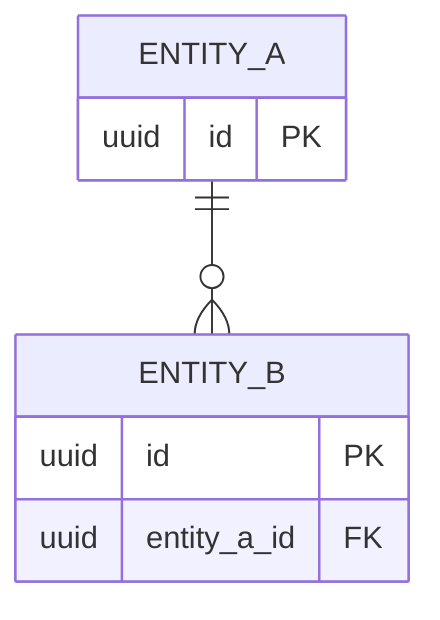
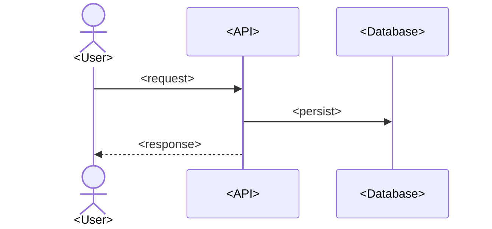

# C4: <system name>

<!--
Diagrams of what the system is, in Mermaid (renders on GitHub). Levels follow
the C4 model (https://c4model.com/): C1 context, C2 containers, C3 components.
Level 4 (code) is replaced by an ERD when the system has a data model.
Node labels use terms from CONTEXT.md. Link ADRs in the prose under a diagram,
not inside Mermaid. Stop at the first level you would have to guess; leave a
TODO instead. Agents fill this file with the `c4-diagrams` skill.
-->

C1 to C3 follow C4; level 4 is an ERD. Terms come from [CONTEXT.md](../CONTEXT.md),
decisions from [adr/](../adr/README.md).

## C1: System context

*Audience:* stakeholder. Who uses the system and which external systems it talks to.

<!-- Omit in-process libraries and SDKs: they are not systems. -->

## C2: Containers

*Audience:* developer, DevOps. What deploys separately and where data lives.

| Container | Technology | Responsibility |
|-----------|------------|----------------|
| <API> | <...> | <...> |

## C3: Components of <container>

<!-- Only for a container with a real internal boundary (for example a pure
library vs the web layer). Delete this section otherwise. -->

TODO: draw when the boundary is decided.

## Data model (ERD)

<!-- Delete if the system has no persistent data model. -->

## Key runtime path

<!-- The one user journey or job that matters, happy path only. -->

## Deployment

<!-- Where each container runs, how many instances, which stores are durable.
Delete for a single local process. -->

TODO: hosts, instances, durable stores.
