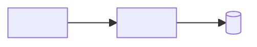

# Threat model: <system name>

<!--
Architecture-level STRIDE threat model for a system you own. Start from C2 in
docs/C4.md; do not invent containers. Analyze flows that cross a trust
boundary. Place every mitigation in a named container and state the residual
risk you accept. Hard-to-reverse mitigations become ADRs.
Agents fill this file with the `threat-model` skill.
-->

**Based on:** [C2](C4.md#c2-containers)
**Date:** <day Month YYYY>

## Assets

<!-- Data, credentials, availability, cost, reputation. Names from CONTEXT.md. -->

- <Asset>: <why it matters>

## Trust boundaries

- <Internet> → <Edge>
- <API> → <Database>
- <Worker> → <External API>

## Data flow

## Threats

<!-- STRIDE: Spoofing, Tampering, Repudiation, Information disclosure,
Denial of service, Elevation of privilege. L = likelihood, I = impact (L/M/H). -->

| ID | Flow | STRIDE | Threat | L | I | Mitigation (where) | Residual risk |
|----|------|--------|--------|---|---|--------------------|---------------|
| T-01 | <User → API> | <D> | <...> | <H> | <H> | <... in API> | <none / accepted because ...> |

## Summary

- **Skipped categories:** <category and why>
- **Top three risks:** <T-NN, T-NN, T-NN>
- **Gaps in C2:** <a store or trust boundary the diagram still hides, or "none">
