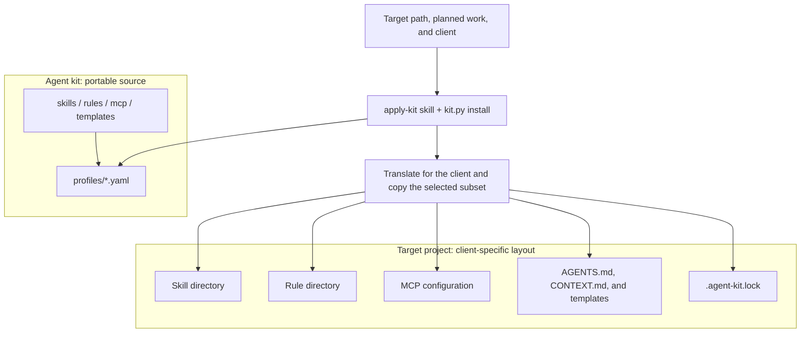

# How it works

Agent kit is a library, not an application. Its assets are written once, in a
client-neutral form, and installed into other projects in the layout each
agent client expects.

## Assets

Skills
:   Folders with a `SKILL.md`: a procedure the agent follows, such as writing an
    ADR or reviewing a diff. Copied as is. See the [skill catalog](skills.md).

Rules
:   Standing instructions (`.mdc` sources). Converted per client: path scoping
    for Claude Code, a managed `AGENTS.md` block for Codex.

MCP definitions
:   JSON fragments with a pinned launch command or a remote URL. Secrets are
    written as `${env:NAME}` and rewritten for each client.

Templates
:   Files copied into the project once: `AGENTS.md`, `CONTEXT.md`, and
    fill-in skeletons for arc42, C4, ADRs, quality scenarios, threat models, and
    hypotheses.

## Profiles

A profile (`profiles/*.yaml`) is the only install list: which skills, rules,
MCP definitions, and templates a project gets. Profiles stack; `core` is always
added. See [Profiles](profiles.md).

## Installing is safe to repeat

- Skills already present are updated from the kit.
- Rules, templates, and MCP entries that exist are skipped unless `--force`.
- `--dry-run` shows every change and writes nothing.
- The installer refuses to run on the kit itself.

## The lock file

`.agent-kit.lock` records the kit revision, the clients, the profiles, and every
installed item. The `apply-kit` skill reads it to find the kit again when you
add or refresh profiles later.
